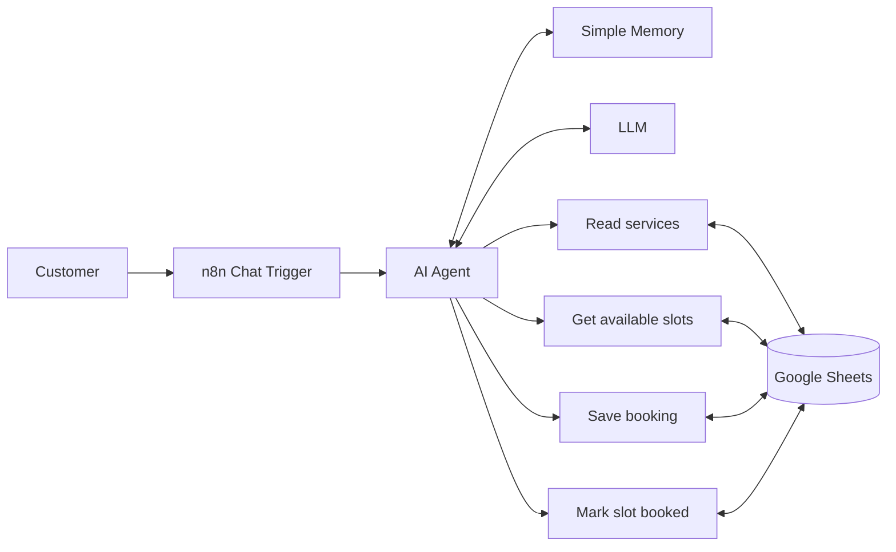

# Salon Booking Chatbot

An AI chatbot that answers customer questions and manages appointments for a salon. It runs on [n8n](https://n8n.io), uses a large language model for the conversation, and stores services, time slots, and bookings in Google Sheets. Customers chat through a web link, which can be shared as a QR code at the salon.

> **Status:** working prototype. The bot runs as a web chat today. WhatsApp integration is in progress (see [Roadmap](#roadmap)).

## Features

- Answers questions about services, prices, and durations, read live from a Google Sheet
- Shows only the time slots that are actually free and never offers a slot that is already booked
- Books appointments in a guided conversation: name, phone, service, then slot, then confirmation
- Supports up to 3 services per booking, with consecutive or separate slots
- Cancels and reschedules existing bookings and frees the old slots
- Keeps prices fixed: no discounts and no negotiation
- Replies in English or Roman Urdu, matching the customer's language
- Re-checks slot availability right before saving, so two customers cannot take the same slot

## How it works



The AI Agent follows the rules in [`prompts/system-message.md`](prompts/system-message.md) and uses Google Sheets tools to read data and write bookings.

## Tech stack

| Part | Tool |
|---|---|
| Workflow automation | n8n (Cloud or self-hosted) |
| Language model | OpenAI chat model via n8n credentials |
| Data storage | Google Sheets |
| Customer access | n8n hosted chat link, shareable as a QR code |

## Repository structure

```
salon-booking-chatbot/
├── README.md
├── workflow/
│   └── salon-bot.json          # n8n workflow export
├── prompts/
│   └── system-message.md       # AI Agent system message
├── data-templates/
│   ├── services.csv            # services, prices, durations
│   ├── slots.csv               # appointment slots
│   └── bookings.csv            # bookings (headers only)
└── docs/
    └── screenshots/
```

## Setup

1. **Create the Google Sheets.** Make one spreadsheet for services and slots and another for bookings. Import the files in `data-templates/` as sheets (use *Insert new sheet* when importing, never *Replace*). In the slots sheet, make `SlotID` a unique number per row.
2. **Import the workflow.** In n8n choose *Import from File* and select `workflow/salon-bot.json`.
3. **Add credentials.** Connect your own Google account and LLM API key in n8n. Credentials are not stored in the exported file.
4. **Point the tools at your sheets.** Open each Google Sheets tool in the workflow, replace the `REPLACE_ME` placeholders by selecting your own spreadsheet and tab, and re-select your credentials.
5. **Set the system message.** Paste `prompts/system-message.md` into the AI Agent's *System Message* field and keep the field in expression mode.
6. **Set the time zone.** In workflow settings, choose your local time zone so "today" is correct.
7. **Publish.** Turn on *Make Chat Publicly Available* in the Chat Trigger, publish the workflow, and share the chat link or turn it into a QR code.

## Data format

| Sheet | Columns |
|---|---|
| Services | `Service`, `Price (PKR)`, `Time (minutes)`, `Details` |
| Slots | `Date` (YYYY-MM-DD), `Day`, `Time` (for example `8:00 PM - 8:30 PM`), `Status` (`Available` or `Booked`), `SlotID` |
| Bookings | `Customer Name`, `Phone`, `Service`, `Date`, `Time`, `Status` |

All sample values in `data-templates/` are made up for illustration.

## Security and privacy

- The workflow export contains no API keys, passwords, or real sheet IDs. Identifiers such as the Google Sheet ID and the chat webhook ID are replaced with `REPLACE_ME`, so you add your own after importing.
- Never commit credentials, API keys, or exports taken straight from a live n8n instance without checking them first.
- The bookings sheet stores customer names and phone numbers. Share it only with salon staff.
- Do not commit real customer data to this repository.

## Roadmap

- [ ] WhatsApp integration (WhatsApp Business Platform)
- [ ] Reminder messages before appointments
- [ ] Staff notification when a booking is made
- [ ] Salon info (address, hours) answered from a sheet
- [ ] Reusable version for other businesses, such as clinics

## License

Copyright (c) 2026 Saad Bin Asif. All rights reserved. See [LICENSE](LICENSE).
